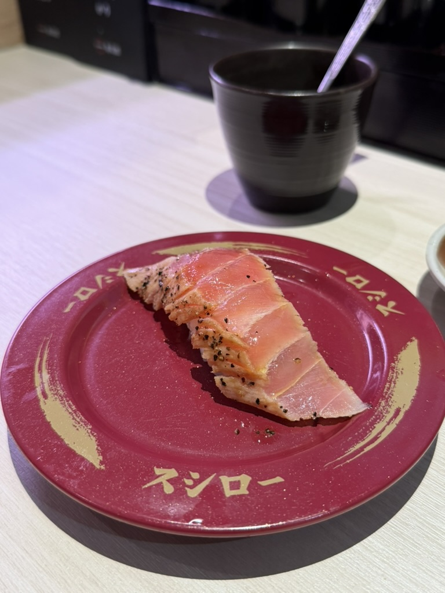
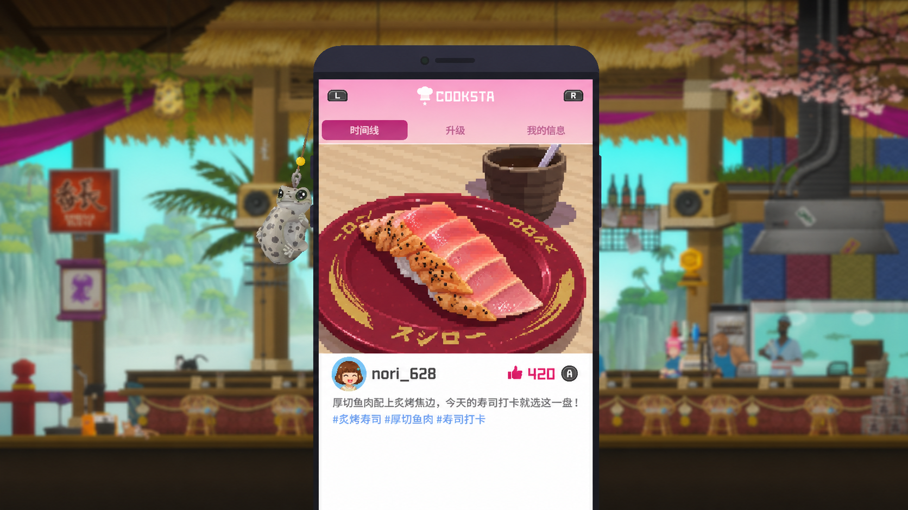
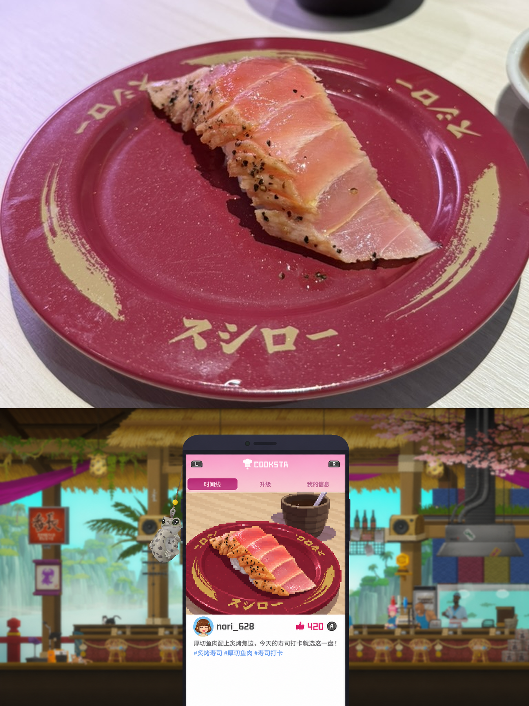
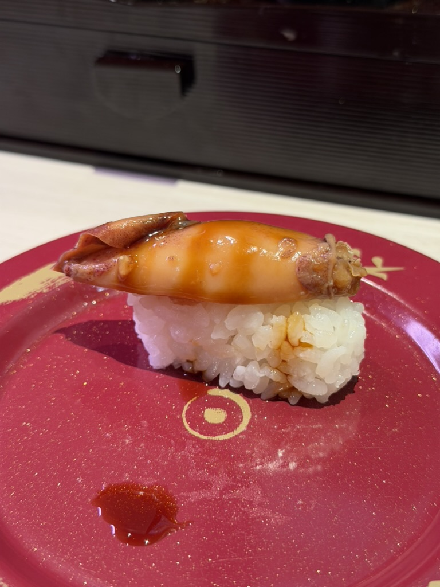
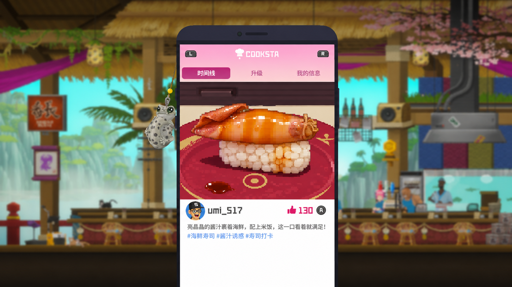
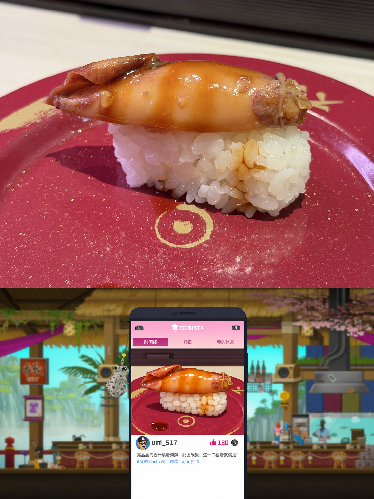

# 在班乔寿司打卡 · PHOTO_FROM_BANCHO

`photo-from-bancho` 是一个将食物照片变成《潜水员戴夫》COOKSTA 风格像素动态的 Skill。它会导出一张 3:4 的 PNG 组合图，上方是实拍，下方是模拟截图，并单独保存模拟截图。

## 示例

| 原图 | 模拟截图 | 组合产物 |
| --- | --- | --- |
|  |  |  |
|  |  |  |

## 让 Agent 帮你安装

把下面的安装指令发给你的 Agent。

```text
从 https://github.com/lizijing98/photo-from-bancho/tree/main/skills/photo-from-bancho 安装完整的 photo-from-bancho Skill。按 Skill 目录里的 AGENT_INSTALL.md 的流程进行检查安装。
```

## 使用

附上一张实拍食物照片，将下面的指令发给 Agent。

```text
使用 photo-from-bancho，把这张照片做成班乔寿司打卡图。
```

只需提供食物照片。Skill 自带 15 张真实 COOKSTA 截图作为底图，只替换手机上的当前动态，其余区域保留原图像素。可以指定配文、Tags、用户名和头像，也可以要求配文分行。未填写的字段会自动生成。

场景可选班乔主店、分店或海上，时段可选白天、傍晚或夜晚，天气可选晴、雨或雾。默认使用「班乔主店＋白天＋晴」，也可以说「用海上＋夜晚＋雨做一张打卡图」。超出内置预设时，可以提供对应截图或选择近似背景。[查看 15 个内置组合](skills/photo-from-bancho/references/scenes.md)

Agent 没有图像工具时，可以先获取生成提示词，再把生成好的截图交给 Agent 拼接。

## 隐私与许可

仓库中的示例照片和内置参考截图已清理隐私元数据。使用在线图像工具时，照片及参考图会按该工具的规则处理。

本项目为非官方同人工作流。代码与文档采用 MIT 许可。内置参考截图来自《潜水员戴夫》，游戏名称、界面和美术的权利归相应权利方。MIT 许可仅适用于本项目的代码和文档。[许可证](LICENSE)
